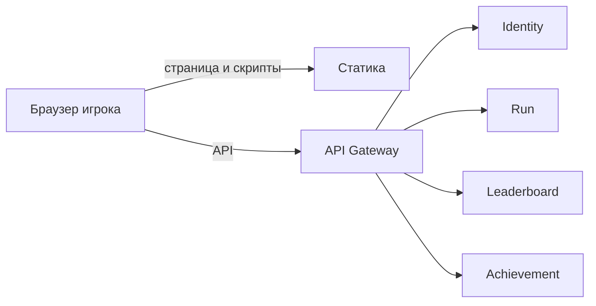
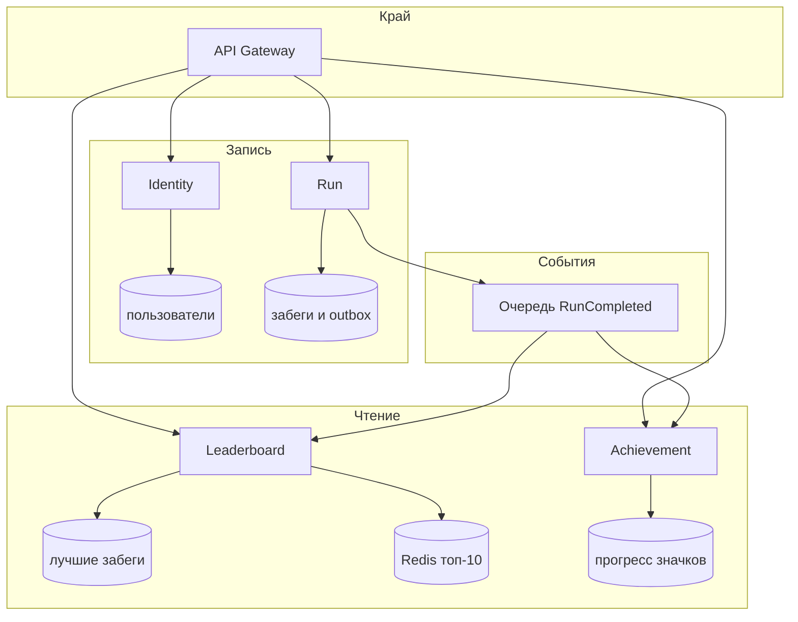
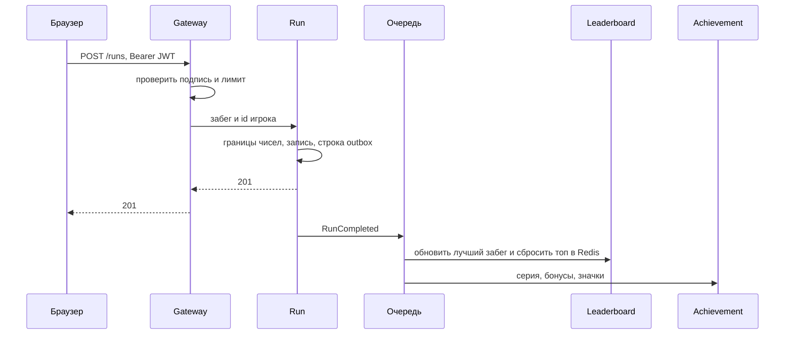
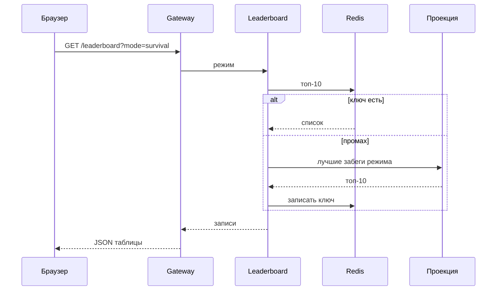

# MSA: XArcanoid Online

Кейс — публичная аркада на базе [XArcanoid](https://github.com/FasterXaos/XArcanoid). Сейчас это один процесс Flask и один файл SQLite: регистрация, сессия, забег, таблица и достижения живут вместе. Ниже та же игра, разложенная на микросервисы.

Физика шара, кирпичи и чертёж уровня остаются в браузере. Сервер не ведёт матч. Он принимает законченный забег, хранит аккаунт и показывает таблицу.

## Функции

1. Регистрация и вход. Сессия переживает обновление страницы.
2. Игрок проходит Кампанию, Выживание или Чертёж. Тренировка в таблицу не пишется.
3. После забега клиент отправляет счёт, уровень, комбо, сложность и режим.
4. Таблица показывает лучший забег игрока в выбранном режиме.
5. Достижения открываются по правилам игры: комбо, серия поражений кампании, набор бонусов, платина.
6. Клиент статики (страница, скрипты, звук) отдаётся отдельно от API.

Чертёж уровня хранится в браузере, как и сейчас. Отдельный сервис раскладок не нужен, пока игрок не делится уровнем с другими.

## Оценка нагрузки

Цифры — учебный сценарий, не замер продакшена. Их хватает, чтобы выбрать паттерны, и мало, чтобы оправдать отдельный кластер на каждый сервис.

| Допущение | Значение |
| --- | --- |
| Зарегистрированные игроки | 50 000 |
| DAU | 5 000 |
| Пик одновременных сессий | 500 |
| Законченных забегов на игрока в день | 4 |
| Доля дневных забегов в пиковый час | 40% |
| Событий достижений на забег | 3 |
| Чтение таблицы активным игроком | раз в 30 с |

Отсюда:

| Поток | Расчёт | Пик, на который проектируем |
| --- | --- | --- |
| Запись забега | 5 000 × 4 × 0,4 / 3 600 ≈ 2,2 запроса/с в пиковый час, всплеск ×10 | **50 записей/с** |
| События в очередь | 50 × 3 | **150 сообщений/с** |
| Чтение таблицы | 500 / 30 ≈ 17 запросов/с, всплеск ×10 | **200 чтений/с** |
| Вход | пачка в начале вечера, не на каждый кадр | **20 запросов/с** |
| Проверка токена | локально на шлюзе, без похода в Identity | не входит в бюджет Identity |

Данные за год, если хранить историю забегов и по одному лучшему результату на режим:

| Данные | Оценка |
| --- | --- |
| Аккаунт | 50 000 × 0,5 КБ ≈ **25 МБ** |
| История забегов | 20 000/день × 365 × 200 Б ≈ **1,5 ГБ/год** |
| Проекция таблицы | 50 000 × 2 режима × 200 Б ≈ **20 МБ** |
| Достижения и прогресс | 50 000 × 100 Б ≈ **5 МБ** |
| Горячий топ-100 | два режима, десятки килобайт в Redis | **< 1 МБ** |

Один Postgres эту нагрузку держит. Деление нужно не из-за объёма, а чтобы таблицу можно было читать и кэшировать отдельно от записи забега, а правила достижений менять без выкладки всего API.

## Сервисы

| Сервис | Делает | Своя база |
| --- | --- | --- |
| API Gateway | Единая дверь, JWT, лимит на `POST /runs`, обрыв при отказе сервиса | нет |
| Identity | Регистрация, пароль, выдача JWT | пользователи, хэши паролей, refresh-токены |
| Run | Принимает забег, проверяет границы чисел, пишет историю, публикует событие | история забегов, исходящие события |
| Leaderboard | Лучший результат игрока в режиме, топ-10 | проекция лучших забегов |
| Achievement | Серия поражений, собранные бонусы, открытые значки | прогресс игрока |
| Статика | Страница и скрипты клиента | объектное хранилище или образ, не база |

Gateway не содержит правил игры. Run не знает, как считается платина. Leaderboard не хранит пароли.

Границы чисел те же, что в текущей игре: счёт 0…999999, уровень 1…9999, комбо 0…9999, сложность `standard` или `overdrive`, режим `campaign` или `survival`. Тренировка и Чертёж на запись не принимаются. Это проверка границ, не античит: клиент сам сообщает результат.

## Паттерны

| Паттерн | Где |
| --- | --- |
| API Gateway | Весь браузерный трафик входит в одну точку |
| Database per service | У Identity, Run, Leaderboard и Achievement свои схемы. Общих таблиц нет |
| CQRS | Run пишет историю. Leaderboard хранит отдельную модель «лучший забег» и не читает журнал Run |
| Transactional outbox | Run пишет забег и строку события в одной транзакции. Отдельный издатель забирает строку в очередь. Забег не теряется, если брокер на секунду недоступен |
| Publish-subscribe | Событие `RunCompleted` получают Leaderboard и Achievement |
| Cache-aside | Топ-10 режима лежит в Redis. Промах читает проекцию и кладёт ключ обратно |
| Circuit breaker | Шлюз перестаёт звать упавший Run и отдаёт ошибку, не копя потоки |
| Idempotent consumer | Повтор `RunCompleted` не двигает игрока в таблице дважды и не открывает значок второй раз |
| Backend for frontend не выделяется | Клиент один, шлюза достаточно |

Согласованность в итоге, не в одной транзакции. Игрок получает `201` сразу после записи забега. Строка в таблице и значок догоняют за доли секунды. Для этой игры окно допустимо: таблица и так обновляется отдельным запросом.

## Контекст

## Сервисы и данные

## Запись забега

Повтор того же `run_id` в Run возвращает уже созданный ответ и не кладёт второе событие.

## Чтение таблицы

Чтение не заходит в Run и не ждёт Achievement.

## Развёртывание

Каждый сервис — свой Deployment. Gateway снаружи, как frontend в задании по Kubernetes: LoadBalancer или NodePort. Остальные — ClusterIP. Redis один на таблицу. Брокер один на события. На этой нагрузке Postgres может быть одним кластером с четырьмя базами: изоляция логическая, паттерн database-per-service сохранён, отдельный кластер на 25 МБ пользователей не заводится.

Шлюз и Run масштабируются по репликам первыми: через них идёт всплеск записи. Leaderboard читает Redis, ему хватает двух реплик. Identity почти не растёт вместе с частотой забегов.
